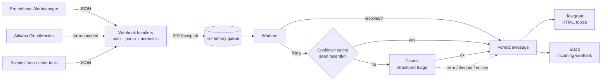

# alert-copilot

A small Go service that receives monitoring alerts, asks Claude for a quick
first-look triage, and posts the result to Telegram (and optionally Slack).

When you get paged at 3 a.m., the alert says *what* fired. alert-copilot adds
a likely cause, its own severity call, the first three checks to run, and
whether the alert looks like noise. If the AI part is slow, down, or not
configured, you still get the raw alert straight away.

## Why

This started as [alicloud-telegram-webhook](https://github.com/rakaprad/alicloud-telegram-webhook),
a tiny Node.js webhook that forwarded Alibaba Cloud CloudMonitor alerts to
Telegram. It worked, but every alert was a bare metric name and number, and
the on-call engineer still had to work out what to look at first.

alert-copilot is the grown-up version:

- **More sources**: Prometheus Alertmanager, Alibaba Cloud CloudMonitor, and a generic JSON endpoint.
- **AI triage** with Claude, returned as structured JSON so the message format never breaks.
- **Built for on-call**: AI is optional, resolved alerts skip AI, repeats reuse the previous triage, and webhooks can require a shared secret.

## How it works



1. Each handler parses its own format into one common `alert.Alert` struct, enqueues it, and returns `202` right away. Slow AI calls never make Alertmanager time out and retry.
2. A small worker pool processes the queue. Resolved alerts go straight to the notifiers.
3. Firing alerts go through `ai.Analyzer`. The production analyzer is Claude wrapped in a cooldown cache, and tests use fakes.
4. Any AI failure (no key, timeout, API error, refusal, bad output) is logged, and the raw alert is sent with a short note.

## Example Telegram message

```
🔴 FIRING · warning · HighCPUUsage
source: alertmanager · target: 10.0.3.17:8080 · value: 94%
CPU usage above 90% for 10 minutes
Pod payments-api-7d9c6b5f8-x2kqj in namespace payments has been using 94% of its CPU limit for 10 minutes.

🤖 AI triage · severity high · noise: no
payments-api is CPU-throttled at its limit; latency for payment requests is likely elevated.
Likely cause: traffic increase or a hot code path since the last deploy; the CPU limit may be too tight for current load.
First checks:
1. kubectl -n payments top pod -l app=payments-api
2. kubectl -n payments rollout history deploy/payments-api
3. rate(container_cpu_cfs_throttled_periods_total{namespace="payments",pod=~"payments-api.*"}[5m])

source
```

> The AI section above is an illustrative example of the format. The
> non-AI parts are exactly what the local smoke test produced.

Without an API key, or when the AI call fails, the triage block is replaced by
a single line such as *AI triage unavailable*.

## Quickstart

Requirements: Go 1.25+, a Telegram bot token and chat id. An Anthropic API key is optional.

```bash
git clone https://github.com/rakaprad/alert-copilot && cd alert-copilot
cp .env.example .env        # fill in TELEGRAM_*, optionally ANTHROPIC_API_KEY
make run                    # starts on :8080

# in another terminal: send the sample payloads from testdata/
WEBHOOK_TOKEN=change-me ./scripts/send-sample.sh
```

Docker:

```bash
docker build -t alert-copilot .
docker run --rm -p 8080:8080 --env-file .env alert-copilot
```

Kubernetes: see `deploy/k8s/` (Deployment with a hardened `securityContext`,
Service, Secret example) and `deploy/alertmanager/receiver.yaml` for the
Alertmanager side.

### Endpoints

| Method | Path | Body |
|---|---|---|
| POST | `/webhook/alertmanager` | Alertmanager webhook JSON (v4) |
| POST | `/webhook/alicloud` | CloudMonitor callback, `application/x-www-form-urlencoded` |
| POST | `/webhook/generic` | `{"name": "...", "status": "firing", "severity": "...", "target": "...", "summary": "...", "description": "...", "value": "...", "labels": {...}}` or an array of these |
| GET | `/healthz` | liveness/readiness |

For CloudMonitor, set the callback URL to
`https://<host>/webhook/alicloud?token=<WEBHOOK_TOKEN>`, because it cannot send custom headers.

## Configuration

All configuration is via environment variables (see `.env.example`).

| Variable | Default | Description |
|---|---|---|
| `LISTEN_ADDR` | `:8080` | HTTP listen address |
| `WEBHOOK_TOKEN` | *(empty)* | Shared secret. Accepted as `Authorization: Bearer`, `X-Webhook-Token`, or `?token=`. Empty disables auth, so use that for local dev only |
| `LOG_LEVEL` | `info` | `debug`, `info`, `warn`, `error` |
| `WORKERS` | `4` | Concurrent alert processors |
| `ANTHROPIC_API_KEY` | *(empty)* | Enables AI triage. Empty = forward raw alerts only |
| `AI_MODEL` | `claude-opus-5-5` | Claude model id |
| `AI_EFFORT` | `low` | `low` / `medium` / `high` / `xhigh` / `max`. Triage is a short task, and `low` keeps it fast and cheap |
| `AI_MAX_TOKENS` | `2048` | Hard cap on output tokens per alert |
| `AI_TIMEOUT` | `30s` | Total time budget for one analysis, retries included |
| `AI_COOLDOWN` | `30m` | Reuse a triage for the same alert fingerprint for this long |
| `TELEGRAM_BOT_TOKEN` | *(empty)* | Bot token from @BotFather |
| `TELEGRAM_CHAT_ID` | *(empty)* | Chat id (e.g. `-1001234567890`) or `@channel` |
| `TELEGRAM_THREAD_ID` | `0` | Forum topic id (`message_thread_id`). `0` = main chat |
| `TELEGRAM_API_URL` | `https://api.telegram.org` | Override for testing |
| `SLACK_WEBHOOK_URL` | *(empty)* | Optional Slack incoming webhook |

At least one notifier (Telegram or Slack) must be configured.

## Prompt injection: alert content is untrusted

Alert text can contain anything: log lines, user input that ended up in an
error message, or a label someone set on purpose. alert-copilot treats it as
untrusted data at every step.

- **Separate channels.** Instructions live only in the system prompt. The alert goes in the user turn as JSON inside `<alert_data>` tags, and the system prompt says to treat it as data and never follow instructions inside it.
- **The data can't escape its tags.** Go's `encoding/json` escapes `<` and `>` to `<`/`>`, so a description containing `</alert_data>` cannot close the block early (there is a unit test for this).
- **No tools, no actions.** Claude has no tools. The worst a successful injection can do is produce misleading text in a chat message, and the raw alert is always shown above it.
- **Constrained output.** Structured outputs force the response into a fixed JSON schema (severity is an enum, max 3 checks enforced in code). Every field is HTML-escaped for Telegram and mrkdwn-escaped for Slack, so the model can't inject markup, links, or `<!channel>` pings.
- **Read-only suggestions.** The prompt asks for read-only checks only, and they are shown as text for a human to review. Nothing is ever executed.
- **Bounded input.** Long fields are truncated before being sent, which also caps cost.

## Cost

Triage is a small, bounded call:

- **Resolved alerts never call the API.**
- **Cooldown cache.** Alertmanager `repeat_interval` and CloudMonitor re-send firing alerts. The same alert fingerprint reuses the cached triage for `AI_COOLDOWN` (default 30 minutes). Failures are not cached, so the next repeat tries again.
- **Small caps.** `AI_MAX_TOKENS=2048`, `AI_EFFORT=low`, and input fields truncated to about 2 KB each. A typical alert is roughly 1–2K input tokens and a few hundred output tokens.
- To go cheaper still, set `AI_MODEL` to a smaller model such as `claude-haiku-5-5`.

## Development

```bash
make vet test lint build
```

Tests cover parsing for each source (with realistic payloads in `testdata/`),
Telegram and Slack formatting and escaping, the AI fallback path, the cooldown
cache, token auth, and the Claude client against a local fake of the Messages
API. **No test calls the real API.**

```
cmd/alert-copilot/     main: config, wiring, graceful shutdown
internal/alert/        common Alert type + fingerprint
internal/source/       Alertmanager / CloudMonitor / generic parsers
internal/ai/           Analyzer interface, Claude client, cooldown cache
internal/notify/       Telegram + Slack formatting and senders
internal/server/       HTTP handlers, auth, worker pool, processing
internal/config/       env var loading and validation
```

## Design notes

- **Server-side refusal fallback.** The Claude request enables the API's server-side fallback (`fallbacks: "default"`, beta `server-side-fallback-2026-07-01`), so a request declined by a safety classifier is retried on a suitable fallback model. If the whole chain still refuses, the alert is forwarded raw.
- **Retries and timeouts.** The Anthropic SDK retries 429/5xx and connection errors (2 retries). Each attempt gets half of `AI_TIMEOUT`, and the whole analysis is bounded by `AI_TIMEOUT`.
- **Graceful shutdown.** On SIGTERM the HTTP server stops accepting requests, then the workers finish alerts that were already accepted.

## Roadmap

- [ ] Shared cooldown cache (Redis) so the service can run with more than one replica
- [ ] More sources: Grafana alerting, Datadog, Uptime Kuma
- [ ] Prometheus `/metrics` (alerts received, AI latency, fallbacks, tokens used)
- [ ] Optional context enrichment, e.g. recent deploys or `kubectl describe` output fed to the prompt, read-only
- [ ] Telegram inline buttons (ack / silence via Alertmanager API)
- [ ] Per-route model/effort overrides (e.g. higher effort for `severity=critical`)

## License

MIT © 2026 Raka Pradipta
